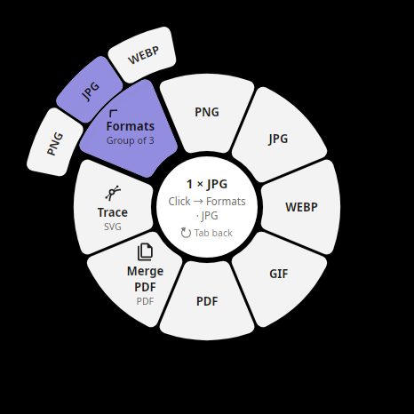
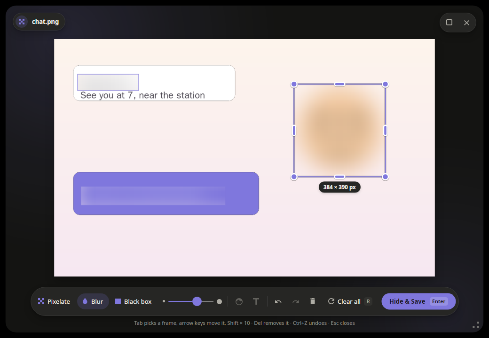
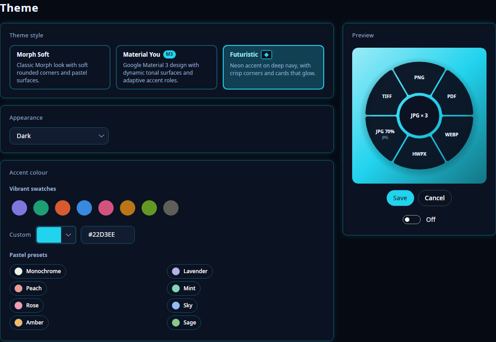
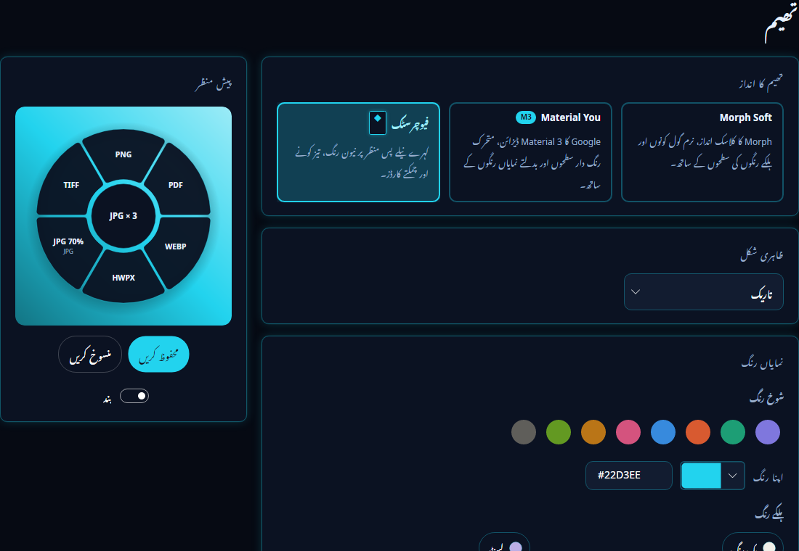

<p align="center">
  
</p>

<h1 align="center">Morph</h1>

<p align="center">
  <b>Drag, drop, converted.</b><br>
  Convert, shrink, blur, print and share files without opening an app.<br>
  Free and open source, for Windows, Linux and macOS. Everything happens on your own computer.
</p>

<p align="center">
  <a href="#download"><b>Download</b></a> ·
  <a href="#how-it-works"><b>How it works</b></a> ·
  <a href="#what-it-can-do"><b>What it can do</b></a> ·
  <a href="#whats-new-in-morph"><b>What's new</b></a> ·
  <a href="#build-from-source"><b>Build from source</b></a>
</p>

<p align="center">
  <a href="https://github.com/admknight/Morph/actions/workflows/ci.yml"></a>
  <a href="LICENSE"></a>
  
  
  
  
</p>

<p align="center">
  
</p>

<table>
  <tr>
    <td width="33%" valign="top">
      <b>Right at your cursor</b><br>
      Hold <kbd>Ctrl</kbd> and drag files. A ring of choices opens where you are, with only the ones that fit
      those files. No app window to open.
    </td>
    <td width="33%" valign="top">
      <b>About 270 formats, offline</b><br>
      Pictures (RAW, HEIC too), PDF, Word, Excel, PowerPoint, HWP, CorelDRAW, e-books, archives, fonts, CAD,
      3D models, audio and video.
    </td>
    <td width="33%" valign="top">
      <b>Stays on your computer</b><br>
      No account, no uploads, no tracking. The result lands next to the original, which is never changed.
    </td>
  </tr>
</table>

## Download

> **The first release (0.7.0) is on its way.** Until it's published here under
> [Releases](https://github.com/admknight/Morph/releases), the newest build of every change is on the
> [Actions page](https://github.com/admknight/Morph/actions/workflows/ci.yml): open the latest green run and download
> `windows-arm64-package` or a `portable-*` file (GitHub asks you to sign in for these).

- **Windows 10/11:** run `Morph-<version>-win-Setup.exe`, or unzip the portable `.zip` and run `Morph.exe`.
  Setup needs no admin rights and nothing else installed. It isn't code-signed yet, so if Windows says
  *"Windows protected your PC"*, click **More info → Run anyway**.
- **Linux x64/ARM64** (Ubuntu 22.04 or newer): unpack and run `./install.sh` (no root needed). Drag gestures need X11;
  on Wayland use the drop zone and the file manager's right-click menu.
- **macOS 13+:** unpack and run `./install.sh`, or drag Morph to Applications. The first start needs
  System Settings → Privacy & Security → **Open Anyway**.

Morph can sit beside Filee: settings, folders and menus are separate.

## How it works

**1. Hold <kbd>Ctrl</kbd> and drag your files.** (<kbd>Option</kbd> on a Mac.) From Explorer, Finder, the desktop or a
browser. The donut opens with the choices that fit what you're dragging.

<p align="center"></p>

**2. Let go on what you want.** The new file appears next to the original. Let go in the middle, or press
<kbd>Esc</kbd>, to cancel.

**3. Want more?** Press <kbd>Tab</kbd> (or roll the mouse wheel) to flip the donut to its back: tools like crop, rotate,
compress, remove the background, and the file actions. Slices with a corner mark open into a small group.

**No dragging?** Select files and press the shortcut, right-click them and choose **Convert with Morph**, or drop them on
the Home page. A screenshot on the clipboard works too.

New here? Morph's first start walks you through it with a practice picture you convert yourself.

## What it can do

| | |
|---|---|
| **Convert** | Pictures: PNG, JPG, WebP, AVIF, HEIC, GIF, TIFF, ICO, SVG, RAW and more · PDF to pictures, Word, Excel, text · Word, Excel, PowerPoint and HWP to PDF · CorelDRAW to PDF, SVG, PNG (built in, no LibreOffice) · e-books · fonts · CAD and 3D · audio and video |
| **Tools** | Crop, rotate, flip, resize, compress to a size · remove a background · trace to SVG · **social sizes** (square post, story, video thumbnail, cropped, never squashed) · **normalize volume** · cut clips · merge PDFs, pictures, videos · OCR to searchable PDF · edit or remove metadata · upscale |
| **Hide** | Pixelate, blur or black-box parts of a picture. **Find faces** and **Find text** frame them for you to check before saving. |
| **File actions** | Copy path or name · show in folder · open a terminal there · **share** (Windows' Share panel, the Mac share menu) · **print** · **keep on shelf** |
| **Picture actions** | Copy the text in a picture (OCR) · **colour palette** · set as wallpaper · **search the web** for the picture (the only action that uploads anything, and its name says so) |
| **Your own actions** | **Run a program** with the files: pick an installed app (*Open in Photoshop*, *Open in VS Code*) or write a command, for the file types you choose |

<p align="center"></p>

## Make it yours

- **Templates.** A template is a whole set of donuts and their size. Start with **Morph default** (bigger, with the new
  tools placed) or **Filee classic**, then save your own (Settings → Toolbar → Templates). Switching first keeps your
  current donuts as a template, so you never lose a layout.
- **Donuts per file type**, each with a front and a back, up to 12 slices a side and groups of 6. Drag slices in and out
  in Settings → Toolbar.
- **Your own presets:** size, quality, pages, output folder, file names. Watch folders convert whatever lands in them.
- **Three looks:** Morph Soft, Material You and **Futuristic** (neon accent on deep navy), each light or dark.
- **24 languages**, right-to-left included: Arabic, Persian and **Urdu** in a Nastaliq font.

<p align="center">
  
  
</p>

## Private and safe

- **Nothing leaves your computer.** Conversions, face finding and text finding all run locally. The only exceptions are
  ones you choose: "Search the web" sends a small copy of the picture (without its location or camera data) to
  Google Lens, and optional engines download once from their official sites, each checked against a pinned SHA-256.
- **A bad file can't take Morph down.** Engines run in separate worker processes with a memory ceiling and a time
  limit. If one crashes or hangs on a broken file, only that file fails, with a clear message. If your PC loses power
  mid-way, Morph offers to finish the rest at the next start.
- **Updates install themselves while Morph isn't in use**, after their signature is checked (Settings → About to turn
  that off).

## What's new in Morph

Morph started in November 2026 as a fork of [Filee](https://github.com/KnifeLemon/Filee) and keeps all its features.
On top of that it adds:

- The donut **opens where you want it**: where you let go, following your cursor, or where the drag started.
- **Crash-proof conversions** and **resume after a power cut**.
- A **guided first run** with a practice picture, the **Futuristic** look, **Urdu**, and **layout templates** with a bigger default donut.
- From [OrbitDrop](https://github.com/i3sam/OrbitDrop)'s ideas: file and picture actions, run a program, print, share,
  shelf, social sizes, normalize volume, colour palette, web search, find faces and text, a CorelDRAW reader without
  LibreOffice, worker limits, idle updates, and picking up the selection in Explorer's Gallery and in VS Code.

<!-- sponsors: src/Filee.App/Assets/Sponsors/sponsors.json -->

## Build from source

You need the [.NET 10 SDK](https://dotnet.microsoft.com/download).

```bash
git clone https://github.com/admknight/Morph.git
cd Morph
dotnet run --project src/Filee.App          # the app
dotnet run --project src/Filee.Cli -- help  # the morph command line
dotnet test Filee.slnx                      # the tests
```

The project folders keep Filee's names (`src/Filee.App`, `Filee.slnx`) so Filee's improvements keep merging in;
everything you see says Morph. [build/morph](build/morph/README.md) explains how a Filee release is taken in.
More: [architecture](docs/ARCHITECTURE.md) · [adding a converter](docs/ADDING-A-CONVERTER.md) ·
[adding a language](docs/ADDING-A-LANGUAGE.md) · [engines](docs/ENGINES.md) · [portable mode](docs/PORTABLE.md).

## Credits and license

Morph is MIT-licensed. It's built on [Filee](https://github.com/KnifeLemon/Filee) by Myeonggu Kim (KnifeLemon) and the
Filee contributors (MIT), with ideas and some code from [OrbitDrop](https://github.com/i3sam/OrbitDrop) by i3sam (MIT).
Face finding uses [UltraFace](https://github.com/Linzaer/Ultra-Light-Fast-Generic-Face-Detector-1MB) (MIT); CorelDRAW
files are read with libcdr and librevenge (MPL 2.0). Everything Morph uses is listed in
[THIRD-PARTY-NOTICES.md](THIRD-PARTY-NOTICES.md).

Made by [Adam Knight](https://github.com/admknight).
