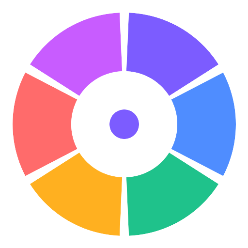

<p align="center">
  
</p>

<h1 align="center">Morph</h1>

<p align="center">
  <b>Drag, drop, converted.</b><br>
  A free, open-source file converter for Windows, Linux and macOS. Hold <kbd>Ctrl</kbd> (<kbd>Option</kbd> on macOS),
  drag your files, and a ring of formats opens where you let go. Everything happens on your own computer.
</p>

<p align="center">
  <a href="LICENSE"></a>
  
  
</p>

> **Early development.** There is no release to download yet; build it from source (below). Morph is built on
> [Filee](https://github.com/KnifeLemon/Filee) by KnifeLemon and keeps its features; Morph's own work is listed under
> [What's different](#whats-different).

## What it does

- **A ring at your cursor.** Hold <kbd>Ctrl</kbd> and drag files from Explorer, the desktop or a browser. Only the
  formats that fit your files appear. Let go on one and the converted file appears next to the original, which is
  never changed.
- **About 270 formats, offline.** Pictures (including RAW and HEIC), PDF, Word, Excel, PowerPoint, HWP, e-books,
  archives, fonts, CAD, 3D models, subtitles and more. Video, audio and rarer formats use optional engines, each
  downloaded once from its official site and checked before use.
- **Yours to arrange.** One donut per file type, with a front and a back, groups, your own presets (size, quality,
  pages, output folder, file names), watch folders, shortcuts and themes.
- **Nothing leaves your computer.** No account, no uploads, no tracking.

## What's different

Morph started as a fork of Filee in November 2026. So far it adds:

- **The donut opens where you want it** (Settings → Shortcuts): where you let go of the files (a small bubble rides
  with your cursor), following you until you pause, or where the drag started.
- **Its own identity**: Morph and Filee can be installed side by side; settings, folders and menus are separate.
- **Engines come only from their official sources**, each checked against its pinned SHA-256.
- **Urdu (اردو)**: the whole app, Setup and the macOS menus, right to left in a Nastaliq font. 24 languages in all.

Coming next:

- **Crash-proof conversions**: each conversion in a process of its own, so a broken file or engine can't take Morph
  down, and unfinished work picks up again after a crash.
- **A Futuristic look** beside "match my computer".
- **A guided first run** with a practice conversion, simple enough for anyone.

## Build from source

You need the [.NET 10 SDK](https://dotnet.microsoft.com/download).

```bash
git clone https://github.com/admknight/Morph.git
cd Morph
dotnet run --project src/Filee.App          # the app
dotnet run --project src/Filee.Cli -- help  # the morph command line
dotnet test Filee.slnx                      # the tests
```

The project folders keep Filee's names (`src/Filee.App`, `Filee.slnx`) so that Filee's improvements keep merging in;
everything you see says Morph. [build/morph](build/morph/README.md) explains how a Filee release is taken in.

## Credits and license

Morph is MIT-licensed. It is built on [Filee](https://github.com/KnifeLemon/Filee) by Myeonggu Kim (KnifeLemon) and the
Filee contributors, also MIT. The software Morph uses is listed in [THIRD-PARTY-NOTICES.md](THIRD-PARTY-NOTICES.md).

Made by [Adam Knight](https://github.com/admknight).
